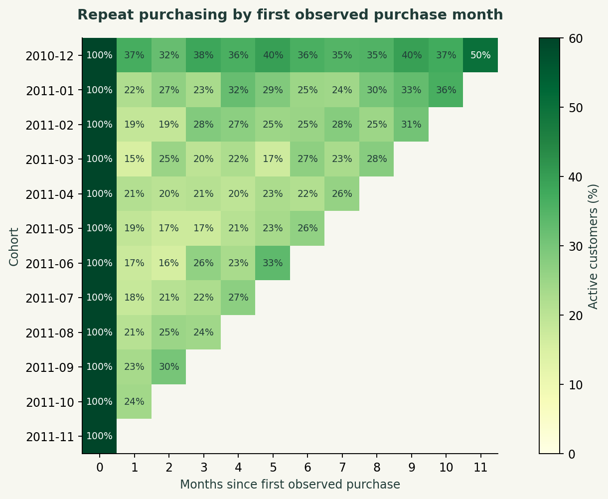
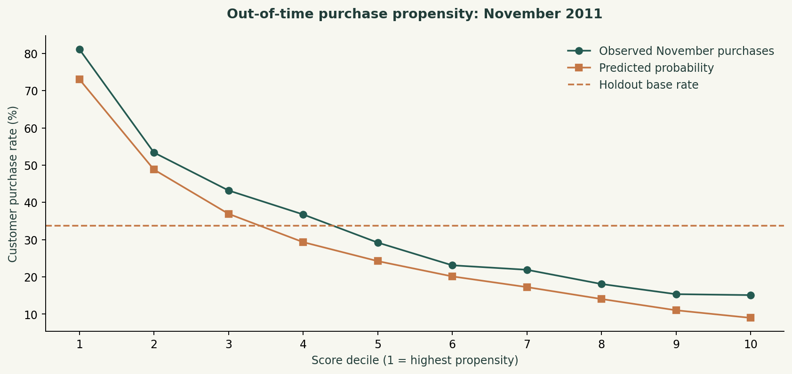

# Retail retention and repeat-purchase targeting

Daniel Umeadi · CRM / commercial analytics

## Business question

Which existing customers should be prioritized for a measured repeat-purchase campaign?

## Results

4,297 identified customers; 23.65% weighted month-one retention. November top-fifth propensity lift is 1.99×, against 1.43× for a simple recency rule. Average precision: 0.634; holdout purchase prevalence: 0.337.

Open **outputs/report.html** to read the complete illustrated case study offline. The HTML can also be printed to PDF using a browser.

## Methods

SQL CTEs, window functions, customer-order modeling, cohort maturity, RFM, logistic regression, out-of-time validation.

## Reproduce

Tested with Python 3.12. Create a virtual environment, activate it, and run these commands from this project folder:

```bash
python -m pip install -r requirements.txt
python test_logic.py
python run.py
```

On Windows, create an environment with `py -3.12 -m venv .venv` and activate `.venv\Scripts\activate`. On macOS/Linux use `python3 -m venv .venv` then `source .venv/bin/activate`.

`run.py` verifies source hashes, rebuilds the DuckDB database and refreshes the results. Missing retail and taxi sources download automatically. CFPB data is downloaded from its official API. Historical exports can change; the source hash detects revisions.

Open `analysis.ipynb` in Jupyter to explore the saved results or rerun the pipeline.

## Source and analytical window

Full UCI Online Retail, Chen (2015), CC BY 4.0. Source dates: 2010-12-01 to 2011-12-09. Analytical window ends before 2011-12-01.

- [Chen, D. (2015). Online Retail. UCI. DOI: 10.24432/C5BW33. CC BY 4.0](https://archive.ics.uci.edu/dataset/352/online+retail)

## Data model and definitions

source_retail: invoice line → lines/purchases: eligible invoice line → customer_orders: CustomerID × InvoiceNo → rfm: customer; cohorts: first-observed month × age; features: customer × snapshot.

Positive value = sum(Quantity × UnitPrice) where quantity and price are positive and invoice is not a cancellation. Retention = distinct active customers / original cohort customers. Month-one headline weights by cohort sizes and excludes immature cohorts. Model lift = top-fifth purchase rate / holdout purchase rate.

`DATA_DICTIONARY.md` explains fields and exclusions. SQL uses the **DuckDB dialect**; functions such as `date_diff`, `generate_series` and `quantile_cont` may need changes for PostgreSQL or SQL Server.

## Files

- `run.py`: data preparation, SQL orchestration, Python analysis and reporting.
- `sql/`: numbered, commented SQL transformations and analytical queries.
- `analysis.ipynb`: analysis walkthrough and saved results.
- `test_logic.py`: small boundary fixtures that test definitions and exclusions.
- `sources.json`: URLs, exact byte sizes and SHA-256 hashes.
- `outputs/`: report, four PNG charts, analytical tables, metrics and quality checks.
- `common.py`: download, export and presentation helpers.

Source data retains the provider's terms. The MIT license applies to project code.

## Validation

Boundary tests cover date cutoffs, missing values, joins and the meaning of retained records. Pipeline assertions reconcile key SQL totals with independent pandas counts/calculations and check denominators, cohort maturity or forecast separation. See `outputs/quality_checks.json` for the actual run's counts. 

## Limitations

No treatment effect is measured. Customer IDs can be missing. Acquisition dates precede observation for some customers. Identical lines are retained; invoice value is not profit. Model calibration is imperfect in the November holiday period.


## Result previews




