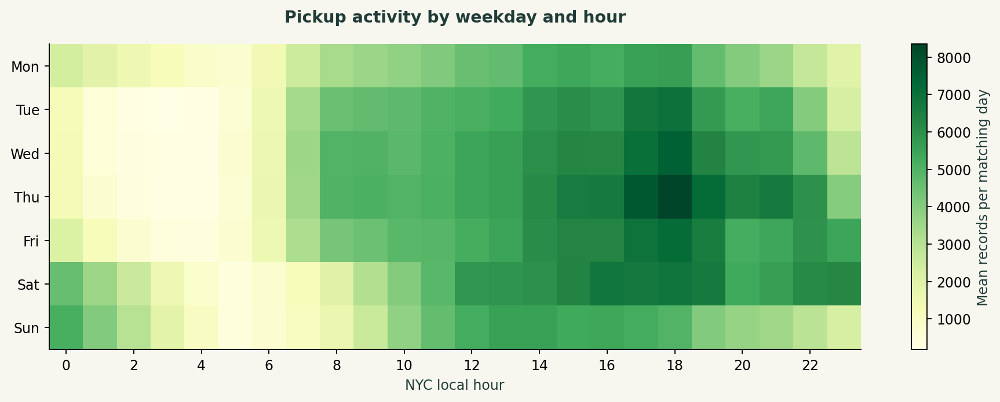
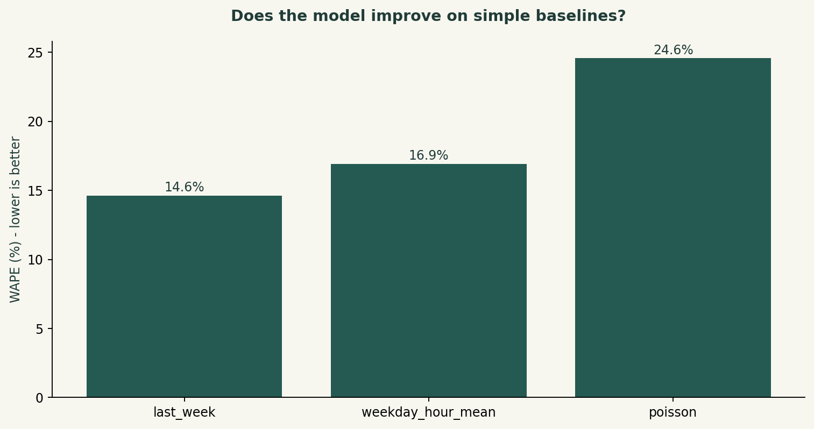

# Taxi demand and operating patterns

Daniel Umeadi · Operations / transport analytics

## Business question

Where and when are qualified pickups concentrated, and does a calendar model beat weekly demand baselines?

## Results

2,914,490 qualifying pickup records. Previous-week WAPE is 14.62%, versus 24.58% for the Poisson model. The simple baseline wins on this holdout; report that result rather than claiming model superiority.

Open **outputs/report.html** to read the complete illustrated case study offline. The HTML can also be printed to PDF using a browser.

## Methods

SQL joins, calendar grids, ranking, window functions, Parquet, Poisson regression, time-ordered backtesting, baseline selection.

## Reproduce

Tested with Python 3.12. Create a virtual environment, activate it, and run these commands from this project folder:

```bash
python -m pip install -r requirements.txt
python test_logic.py
python run.py
```

On Windows, create an environment with `py -3.12 -m venv .venv` and activate `.venv\Scripts\activate`. On macOS/Linux use `python3 -m venv .venv` then `source .venv/bin/activate`.

`run.py` verifies source hashes, rebuilds the DuckDB database and refreshes the results. Missing retail and taxi sources download automatically. CFPB data is downloaded from its official API. Historical exports can change; the source hash detects revisions.

Open `analysis.ipynb` in Jupyter to explore the saved results or rerun the pipeline.

## Source and analytical window

Full January 2024 yellow taxi Parquet plus TLC zone lookup; 2,964,624 source rows. Training January 1–24; test January 25–31. Ten zones selected from training only.

- [NYC TLC trip records and source limitations](https://www.nyc.gov/site/tlc/about/tlc-trip-record-data.page)
- [Yellow taxi data dictionary](https://www.nyc.gov/assets/tlc/downloads/pdf/data_dictionary_trip_records_yellow.pdf)

## Data model and definitions

trips: source record → demand: paid known-zone January pickup record → operations: duration/distance-filtered record; hourly_panel: zone × hour; routes: pickup × drop-off.

Demand counts reported pickup records with positive base fare and pickup zones 1–263. Operational subset additionally requires 1–180 minutes, distance >0 and ≤100 miles, positive total amount. WAPE = sum(abs(actual − forecast))/sum(actual), across individual zone-hour cells.

`DATA_DICTIONARY.md` explains fields and exclusions. SQL uses the **DuckDB dialect**; functions such as `date_diff`, `generate_series` and `quantile_cont` may need changes for PostgreSQL or SQL Server.

## Files

- `run.py`: data preparation, SQL orchestration, Python analysis and reporting.
- `sql/`: numbered, commented SQL transformations and analytical queries.
- `analysis.ipynb`: analysis walkthrough and saved results.
- `test_logic.py`: small boundary fixtures that test definitions and exclusions.
- `sources.json`: URLs, exact byte sizes and SHA-256 hashes.
- `outputs/`: report, four PNG charts, analytical tables, metrics and quality checks.
- `common.py`: download, export and presentation helpers.

Source data retains the provider's terms. The MIT license applies to project code.

## Validation

Boundary tests cover date cutoffs, missing values, joins and the meaning of retained records. Pipeline assertions reconcile key SQL totals with independent pandas counts/calculations and check denominators, cohort maturity or forecast separation. See `outputs/quality_checks.json` for the actual run's counts. 

## Limitations

No unique trip key, no idle-time or supply information, no unmet-demand measure. One month cannot establish yearly seasonality. Cash tips are absent. Analyst-selected quality thresholds affect the operational subset.


## Result previews




