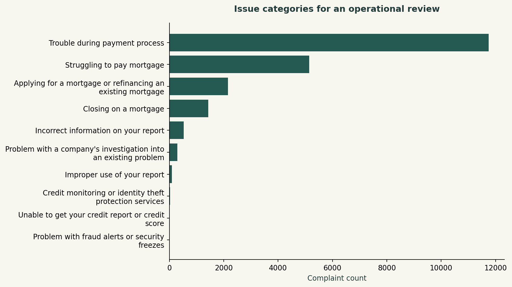
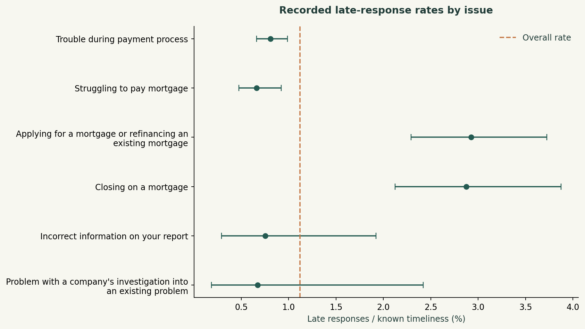

# Mortgage complaint operations

Daniel Umeadi · Financial-services operations analytics

## Business question

Which complaint issues dominate workload, and where should response timeliness be reviewed?

## Results

21,438 mortgage complaints in the 2024 receipt cohort; the two largest issues represent 78.76%. There are 240 late labels (1.12% of known labels).

Open **outputs/report.html** to read the complete illustrated case study offline. The HTML can also be printed to PDF using a browser.

## Methods

SQL dimensional joins, conditional aggregation, Pareto analysis, date boundaries, missing-data handling, Wilson intervals, source auditing.

## Reproduce

Tested with Python 3.12. Create a virtual environment, activate it, and run these commands from this project folder:

```bash
python -m pip install -r requirements.txt
python test_logic.py
python run.py
```

On Windows, create an environment with `py -3.12 -m venv .venv` and activate `.venv\Scripts\activate`. On macOS/Linux use `python3 -m venv .venv` then `source .venv/bin/activate`.

`run.py` verifies source hashes, rebuilds the DuckDB database and refreshes the results. Missing retail and taxi sources download automatically. CFPB data is downloaded from its official API. Historical exports can change; the source hash detects revisions.

Open `analysis.ipynb` in Jupyter to explore the saved results or rerun the pipeline.

## Source and analytical window

CFPB Mortgage CSV export retrieved 2026-10-10; original source SHA-256 recorded in sources.json. Analysis locally enforces 2024-01-01 ≤ receipt < 2025-01-01 because returned max dates differ from API documentation.

- [CFPB Consumer Complaint Database and representativeness limitations](https://www.consumerfinance.gov/data-research/consumer-complaints/)
- [CFPB field reference](https://cfpb.github.io/api/ccdb/fields.html)
- [CFPB API specification](https://github.com/cfpb/ccdb5-api/blob/main/swagger-config.yaml)

## Data model and definitions

complaints / complaint_fact: complaint ID; issue_dimension: unique issue; issue_priority: issue; monthly: receipt month.

Late rate = No / (Yes + No) in Timely response?. Forwarding days = calendar-date difference between received and sent, not response time. Same-day share uses nonnegative known forwarding intervals. Wilson intervals use z=1.96, with no claim of representative sampling.

`DATA_DICTIONARY.md` explains fields and exclusions. SQL uses the **DuckDB dialect**; functions such as `date_diff`, `generate_series` and `quantile_cont` may need changes for PostgreSQL or SQL Server.

## Files

- `run.py`: data preparation, SQL orchestration, Python analysis and reporting.
- `sql/`: numbered, commented SQL transformations and analytical queries.
- `analysis.ipynb`: analysis walkthrough and saved results.
- `test_logic.py`: small boundary fixtures that test definitions and exclusions.
- `sources.json`: URLs, exact byte sizes and SHA-256 hashes.
- `outputs/`: report, four PNG charts, analytical tables, metrics and quality checks.
- `common.py`: download, export and presentation helpers.

Source data retains the provider's terms. The MIT license applies to project code.

## Validation

Boundary tests cover date cutoffs, missing values, joins and the meaning of retained records. Pipeline assertions reconcile key SQL totals with independent pandas counts/calculations and check denominators, cohort maturity or forecast separation. See `outputs/quality_checks.json` for the actual run's counts. 

## Limitations

Complaints are selected, not random or market-share-adjusted. They are not verified wrongdoing. Timely response is not resolution. Confidence intervals assume independent binary outcomes and do not account for clustering. No narratives or personal-profile modeling is performed.


## Result previews




